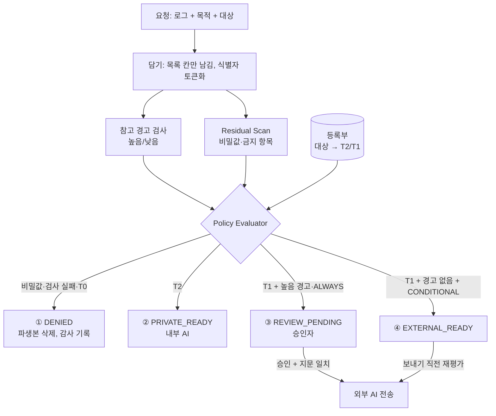

# 17. 경로 분류 기준 — 요청 하나는 어디로 가는가

> 작성 2026-10-27 · 담당 서준영(B) · 8주차 교수님 피드백 대응
> 구현 `GatewayService.create()` → `PolicyEvaluator` (규칙 전체는 16번 문서) · 시험 `GatewayPolicyTest`

## 1. 받은 질문 (8주차 발표, 07:18~13:13)

> "승인자에게 가지 않는 요청이 대부분이라고 했는데, 안전하다고 본 칸(예: 메시지)에 사용자가 카드번호를 넣으면 그냥 나가는 것 아닌가?
> 내부에서 처리하는 것, 승인받고 밖으로 나가는 것을 **무엇을 기준으로 어떻게 분류하는지** 명확히 설명하라."

## 2. 답: 분류는 "칸"이 아니라 "어디로 보내는가 + 무엇이 남았는가" 두 축으로 한다

1. **어디로 보내는가 (대상 등급)** — 요청자가 고르지 않는다. 등록부가 정한다.
   - T2: 조직 내부 AI. 데이터가 조직 밖으로 나가지 않는다.
   - T1: 미리 등록·승인한 외부 AI.
   - T0: 그 밖의 모든 곳(미등록 주소, 개인 계정). 무조건 거부.
2. **무엇이 남았는가 (파생본 검사)** — 담기(칸 목록)를 거친 뒤 **남은 내용 전체**를 다시 본다.
   - 비밀값·금지 항목이 남음 → 어느 대상이든 거부 (Residual Scan, 자동).
   - 개인·금융 정보 모양(카드·주민번호·이메일 등)이 남음 → **높음 경고** (WarningRules, 14번 문서).

"메시지 칸은 안전한 칸"이라고 가정하지 않는다. 칸 목록은 1차로 줄이는 장치일 뿐이고, 남은 칸의 **내용**은 매번 검사한다.

## 3. 경로 분류표

| 경로 | 조건 (위에서부터, 먼저 걸린 줄) | 결과 | 사람 개입 |
| --- | --- | --- | --- |
| ① 자동 거부 | 비밀값·금지 항목이 남음, 또는 검사 실패 | DENIED, 파생본 저장 안 함 | 없음 (요청자가 원본 수정 후 새 요청) |
| ① 자동 거부 | 대상이 T0 | DENIED | 없음 |
| ② 내부 처리 | 대상이 T2 | PRIVATE_READY, 바로 실행 | 없음 (조직 밖으로 안 나감) |
| ③ 승인 후 외부 | 대상이 T1 + 높음 경고 1건 이상 (또는 분류 못 한 칸, 또는 ALWAYS 모드) | REVIEW_PENDING | 승인자가 경고만 보고 판단 |
| ④ 바로 외부 | 대상이 T1 + 높음 경고 0건 + CONDITIONAL 모드 | EXTERNAL_READY | 요청자 확인만, 보내기 직전 재검사 |

승인자에게 가는 것은 ③뿐이다. ①은 사람이 볼 필요 없이 막고, ②는 밖으로 안 나가니 볼 필요가 없다.

## 4. 예시 (실제 요청으로 돌린 결과, `GatewayPolicyTest`)

| # | 넣은 로그 | 대상 | 결과 | 사유 코드 |
| --- | --- | --- | --- | --- |
| 1 | 메시지 칸에 카드번호 `4111-1111-1111-1111` | T1 (조건부 모드) | **승인 대기**. 요청자 혼자 보내면 409 | `T1_HIGH_WARNING` |
| 2 | 같은 로그 | T2 (항상 승인 모드여도) | **내부 처리**. 승인 없이 전송 | `T2_READY` |
| 3 | 메시지 칸에 결제 API 키 `sk_live_…` | T1, T2 둘 다 | **자동 거부**. 파생본 저장 안 함. 감사 기록엔 위치·규칙(STRIPE_KEY)만, 값은 없음 | `RESIDUAL_SECRET_FOUND` |
| 4 | 깨끗한 로그 | 미등록 `personal-chatgpt` | **자동 거부** | `T0_DESTINATION` |
| 5 | 깨끗한 로그 | T1 (조건부 모드) | **바로 외부** | `T1_READY` |

예시 1이 교수님 질문에 대한 직접 답이다. 메시지 칸에 카드번호가 들어가면 경고로 잡혀 **승인자 없이는 외부로 나가지 않는다.**

## 5. 그래도 못 잡는 것 (정의인가 가정인가)

- **가정하지 않는 것**: "높음 경고가 없는 요청에는 민감정보가 100% 없다"고 정의하지 않는다.
- **알려진 빈틈**: 정해진 모양이 없는 민감정보(예: 자유 문장 속 이름, 주소)는 정규식 경고로 잡히지 않는다. ④ 경로로 나갈 수 있다.
- **줄이는 방법**
  - 이런 데이터가 걱정되는 조직은 ④를 끄고(ALWAYS 모드) 모두 ③으로 보내거나, 대상을 T2로 두어 밖으로 내보내지 않는다. 운영자가 고르는 설정이다.
  - 실험(E1)에서 담기 후 놓친 민감 칸은 147개 중 1개였다. 이 수치는 "0이 아니다"를 보여주는 근거로 쓴다.
- **3.5건/일 수치**: 업계 조사(PagerDuty)의 "대응이 필요했던 장애 수"다. 그 장애 로그에 민감정보가 없다는 뜻은 아니다. 승인자 부담 추정에만 쓰고, 안전성 근거로는 쓰지 않는다.

## 6. 정책 흐름 (소프트웨어 아키텍처 중 정책 부분)

그림 파일: `docs/spec/policy_flow.png`

## 7. 테스트 결과

`./gradlew test --tests '*GatewayPolicyTest'` · 2026-10-27 · **7개 중 7개 통과**. 전체 149개 중 148개 통과(실패 1개는 이 변경과 무관한 `PackageGoldenTest` 줄바꿈 문제).

| 테스트 | 결과 |
| --- | --- |
| 메시지 칸의 카드번호는 T1 에서 조건부 모드라도 승인자를 거친다 | 통과 |
| 메시지 칸의 카드번호는 T2 에서는 승인 없이 내부로 처리된다 | 통과 |
| 메시지 칸의 비밀값은 T1·T2 모두 만들 때 거부되고 값이 어디에도 남지 않는다 | 통과 |
| 거부된 요청은 승인하거나 보낼 수 없다 (409) | 통과 |
| T0 대상은 내용이 깨끗해도 거부된다 | 통과 |
| T1 깨끗한 요청은 모드대로 승인 대기 또는 바로 전송 | 통과 |
| 등급 설정은 등록된 대상에만 적을 수 있고 T0 는 적을 수 없다 | 통과 |

바뀐 동작: 등록되지 않은 대상으로 요청하면 예전에는 400 오류로 끝났지만, 이제는 요청이 `DENIED`(정책 거부)로 남고 감사 기록에 사유가 남는다(명세 FL-04). 게이트웨이 화면 상태 목록에 "정책 거부"를 추가했다.
