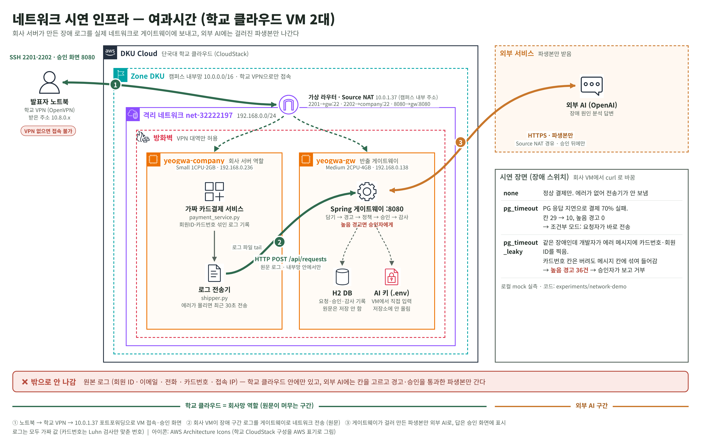

# 네트워크 시연 (회사 서버 → 게이트웨이 → 외부 AI)

11/4 발표 피드백: "로그를 OpenAI 에 보내고 답을 보여 주는 것처럼만 보인다. 회사 시스템 역할 서버를 따로 두고
실제로 네트워크로 메시지를 보내라." 이 폴더는 그걸 위한 시뮬레이터다.



```
 학교 클라우드 (DKU Cloud, net-32222197 192.168.0.0/24)
 ┌──────────────────────────────┐   HTTP POST /api/requests   ┌────────────────────────────┐   HTTPS   ┌──────────┐
 │ yeogwa-company 192.168.0.236 │ ──────────────────────────▶ │ yeogwa-gw 192.168.0.138    │ ────────▶ │ 외부 AI  │
 │  payment_service.py (가짜 결제)│   원문 로그 (회사망 안)        │  Spring 게이트웨이 :8080     │  파생본만  │ (OpenAI) │
 │  shipper.py (장애 감지·전송)   │                             │  담기·경고·정책·승인·감사      │           └──────────┘
 └──────────────────────────────┘                             └────────────────────────────┘
          ▲ ssh 10.0.1.37:2202                                     ▲ ssh 10.0.1.37:2201, 승인 화면 10.0.1.37:8080
          └──────────────── 노트북 (학교 VPN 연결 필요) ─────────────────┘
```

- **payment_service.py**: 가짜 카드결제 서비스. 손님 결제를 스스로 만들어 `checkout-api → payment-service → pg-gateway`
  로그를 OpenTelemetry 형식으로 `logs/payment.jsonl` 에 쓴다. 회원 ID·이메일·전화·카드번호·접속 IP 가 일부러 들어 있다(전부 가짜).
- **shipper.py**: 그 로그 파일을 계속 읽다가 30초 안에 ERROR 가 8건 넘으면 최근 30초를 잘라 게이트웨이로 보낸다.
  요청자 계정 `ops-kim` 으로 로그인한다.
- 둘 다 파이썬 표준 라이브러리만 쓴다. Ubuntu 24.04 기본 python3 로 바로 돈다.

## 장애 스위치 3가지와 끝나는 길

| 스위치 | 무슨 일 | 게이트웨이 결과 (로컬 mock 실측) | 끝나는 길 |
|---|---|---|---|
| `none` | 정상 결제만 | 필드 24→7, 높음 경고 0, T1_READY | (장애가 아니라 전송기가 안 보냄) |
| `pg_timeout` | PG 응답 지연, 결제 70% 실패. 에러 메시지는 깨끗 | 필드 29→10, 높음 경고 0, T1_READY | 조건부 모드: 요청자가 바로 전송 / 항상 모드: 승인 |
| `pg_timeout_leaky` | 같은 장애인데 개발자가 에러 메시지에 카드번호·회원ID·전화를 찍음 | 필드 29→10, **높음 경고 36**, T1_HIGH_WARNING | 승인자가 보고 거부 (또는 오탐 사유 적고 승인) |

`card.number` 칸은 두 장애 모두 담기 목록에 없어서 버려진다. 하지만 `exception.message`·`body` 칸은 원인 분석에 필요해서 담기는데,
그 안에 카드번호가 섞이면 칸 고르기만으로는 못 막는다. 그걸 경고가 잡아서 사람에게 넘긴다. 이게 시연의 핵심 장면이다.

스위치는 회사 VM 에서 `curl -X POST localhost:9000/fault -d mode=pg_timeout_leaky` 처럼 바꾼다.

## 1. 게이트웨이 VM (yeogwa-gw)

노트북에서 학교 VPN 을 켠 뒤:

```bash
ssh -p 2201 <VM 계정>@10.0.1.37

sudo apt update && sudo apt install -y openjdk-17-jdk git
git clone https://github.com/ygsg-dku/yeogwasigan.git
cd yeogwasigan/experiments/yeogwasigan-spring
./gradlew bootJar -x test

# AI 키는 직접 입력한다 (저장소·채팅에 붙이지 말 것). .env 는 .gitignore 에 있다
nano .env
#   YG_AI_PROVIDER=openai
#   YG_AI_MODEL=gpt-5.1-2025-11-13
#   OPENAI_API_KEY=sk-...

export YG_DEMO_PASSWORD='시연용 비밀번호'
export YG_APPROVAL_MODE=CONDITIONAL      # 높음 경고 없으면 승인 없이 전송. 전부 승인받게 하려면 ALWAYS
java -jar build/libs/yeogwasigan-0.1.0.jar
```

노트북 브라우저에서 `http://10.0.1.37:8080/gateway.html` 이 열리면 성공.
SSH 를 끊어도 계속 돌게 하려면 `tmux` 안에서 실행한다.

## 2. 회사 VM (yeogwa-company)

```bash
ssh -p 2202 <VM 계정>@10.0.1.37

git clone https://github.com/ygsg-dku/yeogwasigan.git
cd yeogwasigan/experiments/network-demo/company

# 창 1: 가짜 결제 서비스
python3 payment_service.py --rps 3

# 창 2: 전송기 (게이트웨이는 같은 내부망 주소로 부른다)
export YG_DEMO_PASSWORD='게이트웨이와 같은 비밀번호'
python3 shipper.py --gateway http://192.168.0.138:8080
```

## 화면 E2E 완주 기록

2026-11-07 학교 VM 게이트웨이로 진행한 기록: [docs/E2E_화면_완주_1107.md](docs/E2E_화면_완주_1107.md)

## 3. 시연 순서 (약 3분)

1. 회사 VM 창 1·2 를 보여 준다. "회사 결제 서비스가 돌고 있고, 전송기가 로그를 보고 있다."
2. `curl -X POST localhost:9000/fault -d mode=pg_timeout` → 몇 초 뒤 창 2 에 `장애 감지 … 전송` 과 `REQ-0001 필드 29→10 높음경고=0`.
3. 노트북 `gateway.html` 에서 REQ-0001: 버려진 칸(카드번호·이메일·IP …)과 보낼 파생본을 보여 주고 전송 → AI 답 "PG 연결 풀 고갈로 시간 초과".
4. `mode=pg_timeout_leaky` 로 바꾼다 (전송기는 120초 쉬었다 다시 보낸다. 바로 보내려면 `python3 shipper.py --gateway … --once`).
   REQ-0002 에 높음 경고 36건, 카드번호 위치가 표시된다. `sec-park` 로 로그인해 거부 → 감사 기록에 남는 것을 보여 준다.
5. `mode=none` 으로 되돌린다.

## 로컬에서 한 번에 돌려 보기 (VM 없이)

```bash
# 게이트웨이 (AI 는 mock)
cd experiments/yeogwasigan-spring && ./gradlew bootJar -x test
YG_AI_MOCK=true YG_DEMO_PASSWORD=test YG_APPROVAL_MODE=CONDITIONAL java -jar build/libs/yeogwasigan-0.1.0.jar
# 다른 창
cd experiments/network-demo/company
python3 payment_service.py --rps 8 &
curl -X POST localhost:9000/fault -d mode=pg_timeout_leaky; sleep 12
YG_DEMO_PASSWORD=test python3 shipper.py --gateway http://localhost:8080 --once --window 10
```
