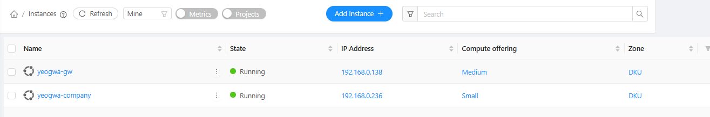
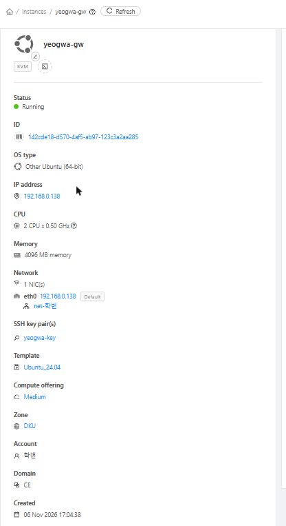
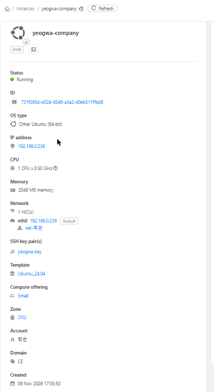
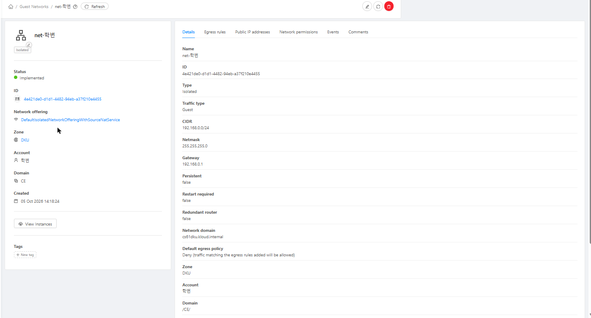
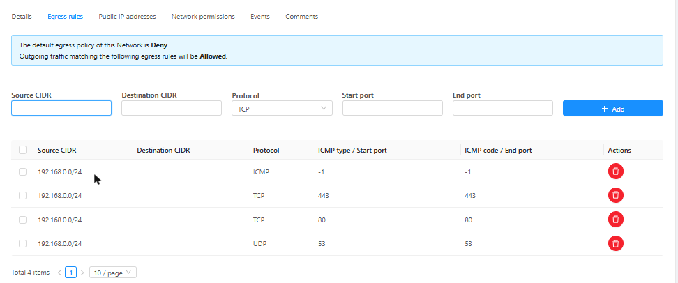
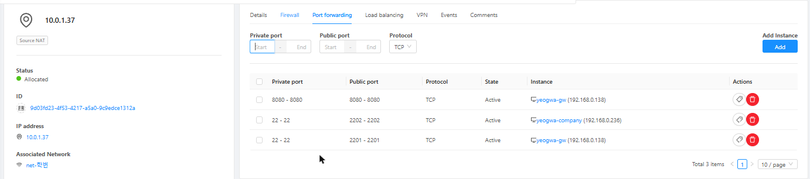
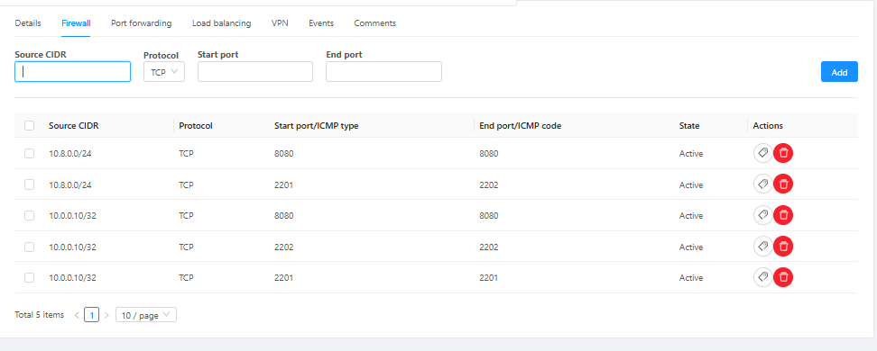
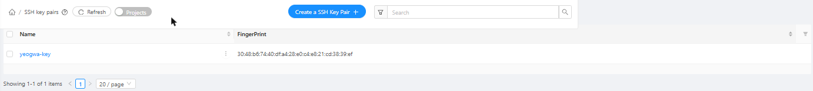

# DKU Cloud 구성 (네트워크 시연 서버)

네트워크 시연용 서버 2대를 학교 클라우드 **DKU Cloud** (`dku.kloud.zone`, Apache CloudStack)에 만든 기록이다.
전체 그림은 [시연_인프라_아키텍처.png](시연_인프라_아키텍처.png) 참고.

> 캡처 화면의 계정 학번과 이름은 `학번`, `사용자` 로 가렸다. 네트워크 이름(`net-학번`)도 실제로는 학번이 들어간다.

## 한눈에 보기

| 항목 | 값 |
|---|---|
| 클라우드 | DKU Cloud (CloudStack), Zone `DKU` |
| 네트워크 | 격리 네트워크 `net-학번`, 192.168.0.0/24, 게이트웨이 192.168.0.1 |
| 공인 IP (Source NAT) | 10.0.1.37. 캠퍼스 내부 주소라 **학교 VPN을 켜야** 접속됨 |
| 게이트웨이 VM | `yeogwa-gw`, Medium (2CPU · 4GB), 192.168.0.138 |
| 회사 서버 VM | `yeogwa-company`, Small (1CPU · 2GB), 192.168.0.236 |
| OS | 템플릿 `Ubuntu_24.04`, 로그인 계정 `ubuntu` |
| 로그인 방식 | SSH 키 `yeogwa-key` (이 템플릿에는 비밀번호 재설정 기능이 없음) |

## 1. 인스턴스 2대

같은 격리 네트워크 안에 두 대를 둔다. 회사 VM 은 게이트웨이를 내부 주소(192.168.0.138:8080)로 직접 부른다.

| 게이트웨이 `yeogwa-gw` | 회사 서버 `yeogwa-company` |
|---|---|
|  |  |

- 게이트웨이는 Spring 서버(Java 17)를 돌리므로 Medium, 회사 서버는 파이썬 스크립트 2개뿐이라 Small.
- 두 VM 모두 SSH 키 `yeogwa-key` 가 붙어 있다.

## 2. 격리 네트워크

- 종류 Isolated, 오퍼링 `DefaultIsolatedNetworkOfferingWithSourceNatService` → 바깥으로 나갈 때 Source NAT(10.0.1.37)를 거친다.
- 기본 나가는 정책이 **Deny** 라서 허용 규칙에 있는 것만 밖으로 나간다.

### 나가는 규칙 (Egress)

| 프로토콜 | 포트 | 쓰는 곳 |
|---|---|---|
| TCP | 443 | 외부 AI(OpenAI) 호출, GitHub 에서 코드 받기 |
| TCP | 80 | 학교 우분투 패키지 저장소(apt) |
| UDP | 53 | DNS |
| ICMP | 전체 | ping 확인 |

게이트웨이 → 외부 AI 는 HTTPS(443)만 쓰므로 이 규칙 안에서 동작한다.

## 3. 공인 IP 10.0.1.37 — 포트포워딩

| 바깥 포트 | → VM:포트 | 용도 |
|---|---|---|
| 2201 | yeogwa-gw:22 | 게이트웨이 SSH |
| 2202 | yeogwa-company:22 | 회사 서버 SSH |
| 8080 | yeogwa-gw:8080 | 승인 화면 (`http://10.0.1.37:8080/gateway.html`) |
| 9001 | yeogwa-company:9000 | 여과은행 인터넷뱅킹 (11/13 추가, 바깥 9000 은 다른 VM 이 사용 중) |
| 9300 | yeogwa-company:9300 | 여과은행 운영 모니터 (11/13 추가) |

처음에는 회사 VM 의 9000 포트를 바깥에 열지 않았다. 11/13 여과은행 화면을 팀원이 보도록 9001·9300 을 추가했다 ([학교서버_여과은행_접속.md](학교서버_여과은행_접속.md)).

## 4. 방화벽 (들어오는 규칙)

| 출발지 | 포트 | 설명 |
|---|---|---|
| 10.8.0.0/24 | 2201–2202, 8080 | 학교 VPN 접속자가 받는 주소 대역 (OpenVPN 접속 시 10.8.0.x) |
| 10.0.0.10/32 | 2201, 2202, 8080 | 처음부터 있던 2201 규칙의 출발지를 따라 만든 규칙 |
| 10.8.0.0/24, 10.0.0.10/32 | 9001, 9300 | 여과은행 화면 (11/13 추가) |

인터넷 전체(0.0.0.0/0)에는 열지 않았다. 학교 VPN 을 켠 사람만 SSH 와 승인 화면에 들어올 수 있다.

## 5. SSH 키

- 노트북에서 `ssh-keygen -t ed25519 -f $HOME\.ssh\dku_yeogwa` 로 키를 만들고, **공개키만** `yeogwa-key` 로 등록했다.
- VM 을 멈춘 상태에서 "Reset SSH key pair" 로 두 VM 에 붙인 뒤 다시 켰다.
- 접속: `ssh -i $HOME\.ssh\dku_yeogwa -p 2201 ubuntu@10.0.1.37` (회사 서버는 `-p 2202`)

## 설치하면서 막혔던 것

| 증상 | 원인 | 해결 |
|---|---|---|
| Reset Password 버튼이 없음 | `Ubuntu_24.04` 템플릿이 비밀번호 기능을 지원하지 않음 | SSH 키 방식으로 변경 |
| `apt install openjdk-17-jdk` 에서 mesa 패키지 Hash Sum mismatch | 학교 저장소(10.0.10.55)가 그래픽 라이브러리 몇 개를 빈 파일로 줌 | 화면 없는 `openjdk-17-jdk-headless` 설치 (서버라 그래픽 필요 없음) |
| 노트북 브라우저에서 10.0.x 주소가 안 열림 | 캠퍼스 내부 주소 | 학교 VPN(OpenVPN) 연결 |
| 게이트웨이 로그인 Invalid credentials | `YG_DEMO_PASSWORD` 를 서버를 켠 창에서 설정하지 않음 | 같은 창에서 `export` 후 실행 |

설치·실행 명령은 [README](../README.md) 1·2번, 화면 완주 기록은 [E2E_화면_완주_1107.md](E2E_화면_완주_1107.md).
