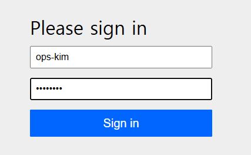
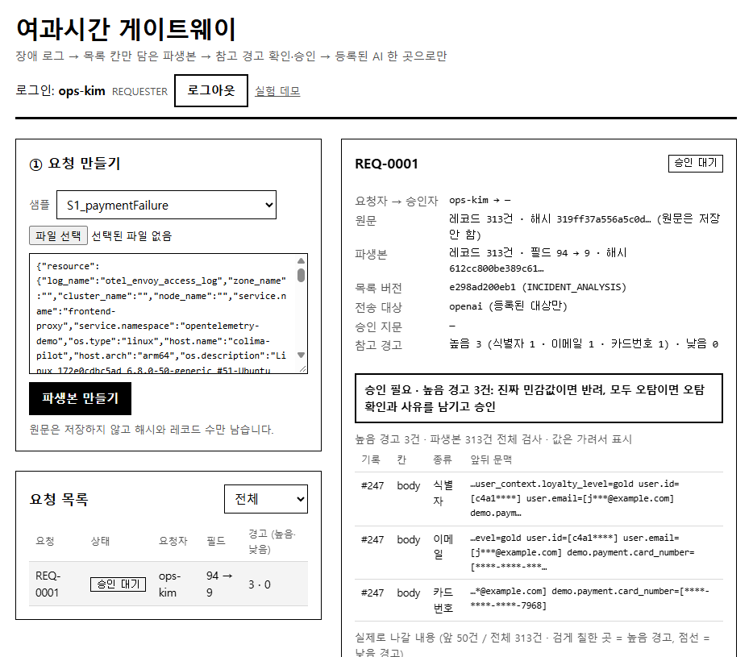
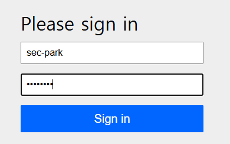
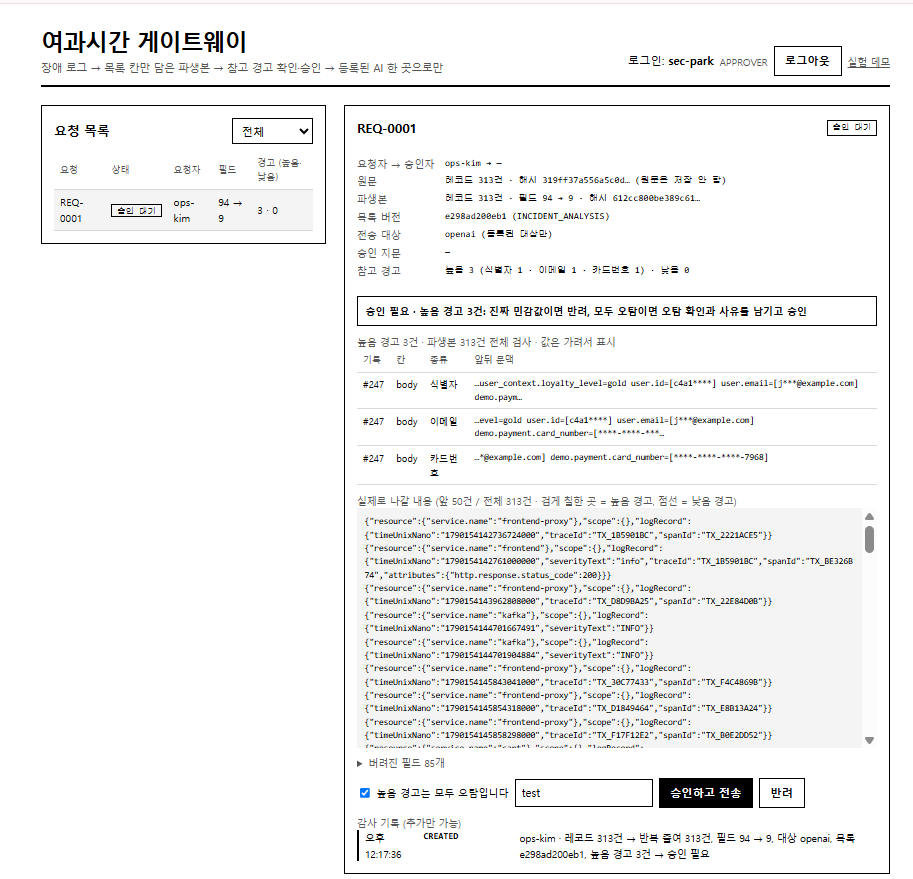
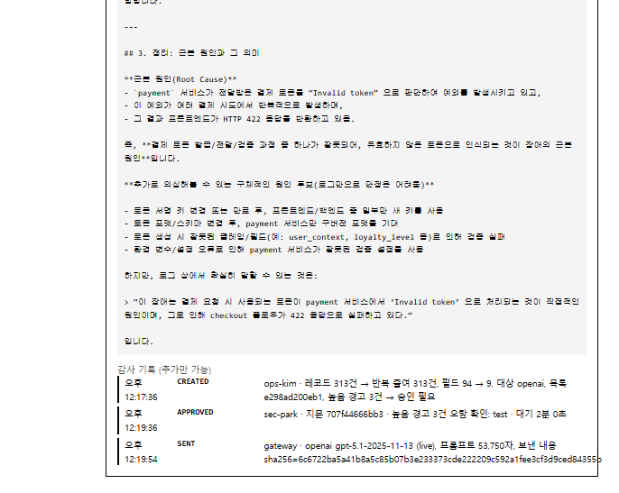

# 화면 E2E 1회 완주 (2026-11-07)

노션 과제 "화면 E2E 1회 완주": OTel 장애 1건을 **로그 올리기 → 승인 → AI 답 → 감사 조회**까지 테스트 코드 없이 웹 화면에서 끝까지 진행한다.

## 환경

| 항목 | 값 |
|---|---|
| 서버 | 학교 클라우드 VM `yeogwa-gw` (192.168.0.138), 노트북에서 학교 VPN → `http://10.0.1.37:8080/gateway.html` |
| 코드 | `main` 브랜치 빌드 (`java -jar build/libs/yeogwasigan-0.1.0.jar`) |
| 승인 모드 | `YG_APPROVAL_MODE=ALWAYS` (모든 요청에 승인 필요) |
| AI | OpenAI `gpt-5.1-2025-11-13`, live 호출 |
| 입력 | 샘플 `S1_paymentFailure` (OpenTelemetry Demo 결제 실패 장애, 레코드 313건) |

## 진행

### 1. 요청자 로그인 (`ops-kim`, REQUESTER)

### 2. 로그 올리기 → 파생본 만들기
샘플 `S1_paymentFailure` 선택 → **파생본 만들기**.
- 결과 `REQ-0001`, 상태 **승인 대기**
- 레코드 313건, 필드 **94 → 9** (버려진 필드 85개)
- 원문은 저장하지 않고 해시만 남음
- 높음 경고 3건: 식별자 1 · 이메일 1 · 카드번호 1 (모두 레코드 #247 `body` 안. 실험용으로 주입한 가짜 값)

### 3. 승인자 로그인 (`sec-park`, APPROVER)

### 4. 승인
요청을 열어 원문·파생본 요약, 높음 경고 위치(값은 가려서 표시), 실제로 나갈 내용(앞 50건), 버려진 필드를 확인.
높음 경고가 있어 **"높음 경고는 모두 오탐입니다"** 체크와 사유 입력 뒤에만 **승인하고 전송** 이 가능함.

> 이번 회차 사유는 `test` 로 적었다. 감사 기록에 그대로 남으므로 발표·제출용 회차는 "실험용 주입 가짜 값, 오탐 확인" 처럼 실제 판단 근거를 적는다.

### 5. AI 답 + 감사 기록
상태가 **전송 완료** 로 바뀌고 AI 답(근본 원인: payment 서비스가 결제 토큰을 `Invalid token` 으로 판단 → 프론트엔드 422)이 화면에 표시됨.

감사 기록 (추가만 가능):

| 시각 | 이벤트 | 내용 |
|---|---|---|
| 12:17:36 | CREATED | ops-kim · 레코드 313건, 필드 94 → 9, 대상 openai, 높음 경고 3건 → 승인 필요 |
| 12:19:36 | APPROVED | sec-park · 지문 707f44666bb3 · 높음 경고 3건 오탐 확인 · 대기 2분 0초 |
| 12:19:54 | SENT | gateway · openai gpt-5.1 (live), 프롬프트 53,750자, 보낸 내용 sha256 기록 |

## 결과

- 네 단계(올리기 · 승인 · AI 답 · 감사 조회)를 화면만으로 끝까지 진행함. 에러 없음.
- 요청자(ops-kim)와 승인자(sec-park)를 다른 계정으로 나눠 진행함.
- 승인부터 전송까지 18초, 생성부터 전송까지 2분 18초.
